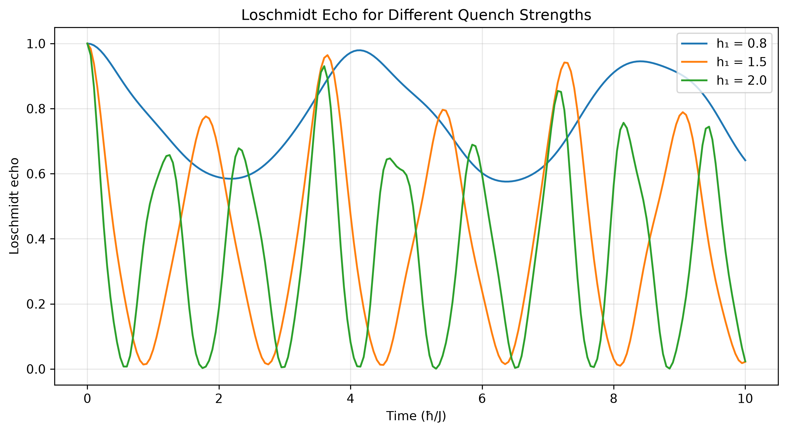
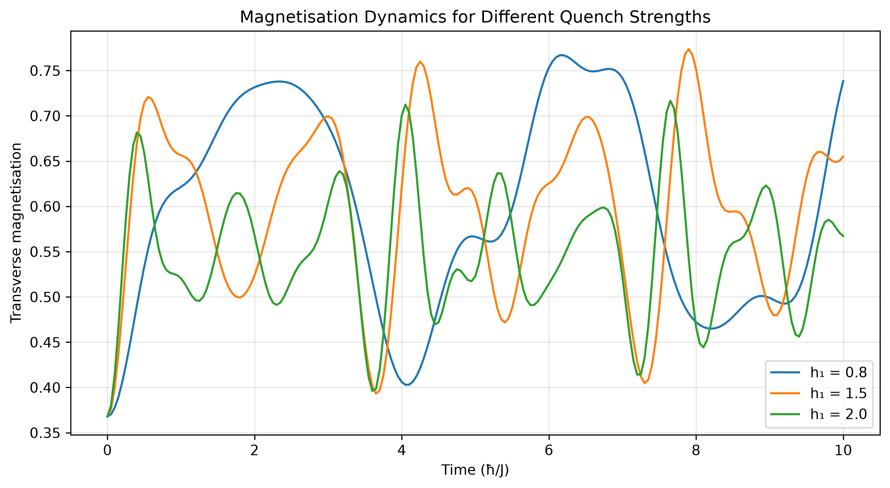

# Nonequilibrium Quantum Dynamics in Spin Chains

Numerical investigation of quantum quench dynamics in finite
spin-1/2 chains using Python, NumPy and SciPy.

## Overview

This project investigates the nonequilibrium behaviour of
finite interacting quantum spin systems following sudden
changes in an external transverse field.

The simulations use the one-dimensional transverse-field
Ising model with open boundary conditions.

The study focuses on the dependence of the Loschmidt echo
and transverse magnetisation on quench strength.

## Physical Model

The Hamiltonian is

H = -J Σ_i σᶻ_i σᶻ_(i+1) - h Σ_i σˣ_i

where:

- J is the nearest-neighbour interaction strength.
- h is the transverse-field strength.
- σˣ and σᶻ are Pauli operators.

The Hilbert-space dimension is 2^N for N spin-1/2
degrees of freedom.

## Numerical Methodology

The Hamiltonian is constructed using tensor products
of Pauli operators and SciPy sparse matrices.

Ground states are obtained using sparse Hermitian
eigensolvers.

For the quantum quench, the system is initially prepared
in the ground state of H(h0). At t = 0, the transverse
field is changed to h1.

The subsequent evolution is calculated using

|ψ(t)⟩ = exp(-i H(h1) t) |ψ0⟩

in units where ℏ = 1.

The matrix exponential is applied directly to the
initial state using scipy.sparse.linalg.expm_multiply.

## Numerical Experiments

System parameters:

- Number of spins: N = 6
- Interaction strength: J = 1
- Initial transverse field: h0 = 0.5
- Final fields: h1 = 0.8, 1.5, 2.0
- Simulation interval: 0 ≤ tJ/ℏ ≤ 10

The initial state is identical across all three
experiments.

## Observables

### Loschmidt Echo

L(t) = |⟨ψ0|ψ(t)⟩|²

Measures the return probability to the initial
quantum state.

### Transverse Magnetisation

Mx(t) = (1/N) Σ_i ⟨ψ(t)|σˣ_i|ψ(t)⟩

Measures the average spin polarisation along
the transverse-field direction.

## Results

The Loschmidt echo displays coherent oscillations
and partial revivals in all three experiments.

The smallest quench (h1 = 0.8) maintains a comparatively
high return probability over the simulated interval.

Larger quenches (h1 = 1.5 and h1 = 2.0) exhibit faster
initial departures from the starting state and
different revival patterns.

Transverse magnetisation also displays quench-dependent
oscillatory behaviour. The three trajectories start
from the same initial value and subsequently diverge.

These observations demonstrate the sensitivity of
finite-system quantum dynamics to the post-quench
Hamiltonian.

## Figures

### Loschmidt Echo Comparison

### Transverse Magnetisation Comparison

## Numerical Validation

The implementation includes tests for:

- Hermiticity of the Hamiltonian
- Correct Hilbert-space dimensions
- Analytical two-spin ground-state energy
- Agreement between two-spin implementations
- Ground-state normalisation
- Hamiltonian eigenvalue equation
- Conservation of wavefunction norm
- Conservation of post-quench energy
- No-quench return probability
- Bounds on the Loschmidt echo

## Limitations

The analysis is restricted to small finite spin chains.

The uniform transverse-field Ising model is integrable.
The present results therefore do not establish
generic thermalisation, many-body localisation,
or thermodynamic critical behaviour.

Exact state-vector simulation also scales exponentially
with the number of spins.

## Installation

Create and activate a Python virtual environment.

Install the dependencies:

    python -m pip install -r requirements.txt

## Reproduce the Results

From the project root:

    python -m pytest -v
    python -m src.energy_scan
    python -m src.compare_quenches

The comparison script saves figures and numerical
results to the figures/ and results/ directories.

## Future Work

Possible extensions include finite-size comparisons,
entanglement dynamics, and disordered interacting
spin-chain models.
